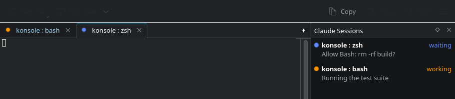
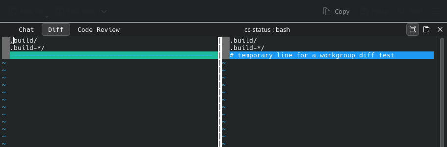
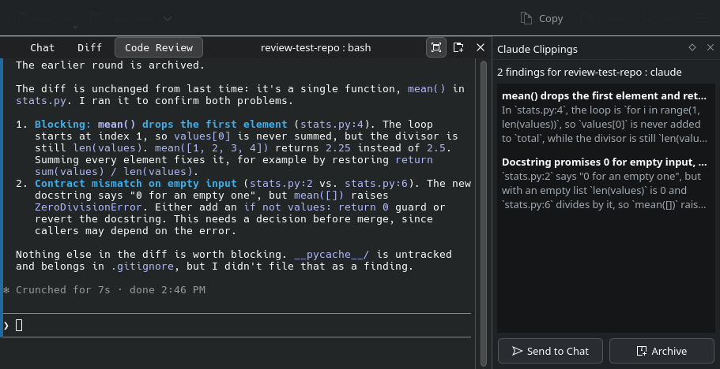

# konsole-claude

[Konsole](https://apps.kde.org/konsole/) with a Claude Code integration modeled
on [iTerm2's](https://iterm2.com/claude-code-integration.html): see what every
[Claude Code](https://claude.com/claude-code) session is doing, get notified when
one needs you, and work with a diff and a code review next to the chat.



## Features

- **Status on every tab.** A dot shows whether Claude is working (orange),
  waiting for you (blue), or done or idle (green). Interrupting a turn with Esc
  shows up too.
- **Claude Sessions panel** (`Ctrl+Shift+F3`). Every Claude session in every
  Konsole window, the ones that need you first, with what each is doing. Click
  one to jump to it.
- **Notifications.** A desktop notification when a session you are not looking
  at needs permission or finishes, with a Show button. Configurable in Konsole's
  notification settings.
- **Workgroups.** Starting `claude` in a tab adds two members beside it, switched
  with buttons in the header bar or `Ctrl+Alt+1/2/3`:
  - **Diff** shows the uncommitted changes (`git difftool -y -x vimdiff` by default).
  - **Code Review** starts a Claude review of the pending changes when you ask.

  

- **Clippings** (`Ctrl+Shift+F4`). A review files each finding; send them to the
  chat with one click, or automatically when the review finishes.

  

- **Optional status badges** in the corner of the terminal, which leave your own
  badges as they were.

## How it works

- Claude Code's hooks run iTerm2's own hook, [`cc-status`](cc-status/), unchanged
  apart from a Linux port. It reports through `it2`, a small stand-in for iTerm2's
  command of that name, which passes the reports to Konsole's Claude Code plugin
  over D-Bus.
- Konsole also understands the escape sequences that report status directly:
  Claude Code's Program Status Protocol ([OSC 7501](https://www.superlogical.com/rex/docs/build/program-status)),
  iTerm2's tab status (OSC 21337), every state of OSC 9;4 progress, and
  `SetUserVar`. Claude Code reports to any terminal that answers its OSC 7501
  query, which is how an interrupted turn is noticed.
- The plugin keeps a status per session with the same rules as iTerm2: a status
  can be scoped to a turn and expire when it ends, is held while background work
  runs, and gives way to whichever source wrote last.

The changes to Konsole are the `claude-integration` branch of
[destinal/konsole](https://github.com/destinal/konsole/tree/claude-integration),
16 commits on top of Konsole 26.08.2 plus one license commit. [`packaging/`](packaging/)
holds the same changes as patches.

## Install (Arch Linux)

The package replaces the `konsole` package and needs Swift to build
(`swift-bin` from the AUR) as well as Konsole's usual build dependencies.

```sh
git clone https://github.com/destinal/konsole-claude
cd konsole-claude/packaging
makepkg -si
```

makepkg checks KDE's signature on the Konsole source. If your keyring doesn't
have the release keys yet, import the ones listed in `validpgpkeys` in the
PKGBUILD with `gpg --recv-keys`.

Then add the hooks to Claude Code's settings (or use **Install Hooks** in the
Claude Sessions panel), and restart Konsole:

```sh
konsole-claude-setup install    # status, uninstall
```

It only touches hooks that run `claude-code-hook`, and backs up
`~/.claude/settings.json` first. To go back: `konsole-claude-setup uninstall`,
then `sudo pacman -S konsole`.

## Using it

| | |
| --- | --- |
| `Ctrl+Shift+F3` | Claude Sessions panel |
| `Ctrl+Shift+F4` | Claude Clippings panel |
| `Ctrl+Alt+1` / `2` / `3` | Workgroup: Chat, Diff, Code Review |
| Plugins menu | Badges, automatic workgroups, automatic sending of findings, hooks |

In **Diff**, press Enter to run the diff again. In **Code Review**, press Enter
to start a review or `e` to edit the review prompt, which is kept in
`~/.config/konsole-claudecode/review-prompt.txt`.

## Updating to a new Konsole release

With a clone of [destinal/konsole](https://github.com/destinal/konsole) on the
`claude-integration` branch:

```sh
KONSOLE_SOURCE=path/to/konsole packaging/update-konsole.sh 26.08.3
```

It rebases the branch onto the release, builds it, runs the tests, and refreshes
the patches and the PKGBUILD. Then build the package as above.

## Status

Built and tested on CachyOS with Konsole 26.08.2 and Claude Code 2.1.296. It
covers most of iTerm2's integration; not yet:

- choosing a file or a git base for the diff (it always diffs against HEAD),
- a status subtitle on tabs (there is a dot),
- tmux, and the hooks over ssh (Claude Code's own reports do work over ssh),
- Codex CLI hooks, which `cc-status` supports but the setup does not install,
- iTerm2's workgroup editor, git and usage toolbar items, and the Orchestrator.

Possible next steps:

- Offer KDE the changes to Konsole that are useful on their own: all OSC 9;4
  progress states, `SetUserVar`, the Program Status Protocol (OSC 7501), the
  session-created signal and the status dot on tabs. The plugin itself would
  stay here, since parts of it are GPL-2.0-only.
- Offer iTerm2 the Linux port of `cc-status`, so it can be built from iTerm2's
  source directly.

## Credits and licenses

- [Konsole](https://invent.kde.org/utilities/konsole) by the KDE community,
  GPL-2.0-or-later.
- [iTerm2](https://github.com/gnachman/iTerm2) by George Nachman and the iTerm2
  authors, GPL-2.0: `cc-status`, and the parts of the plugin ported from iTerm2,
  listed in the plugin's
  [README](https://github.com/destinal/konsole/blob/claude-integration/src/plugins/ClaudeCode/README.md),
  which are therefore GPL-2.0-only.
- The Program Status Protocol by [superlogical](https://www.superlogical.com/rex/docs/build/program-status).

The whole is distributed under the GNU General Public License, version 2 (see
[LICENSE](LICENSE)). Written with Claude Code.
